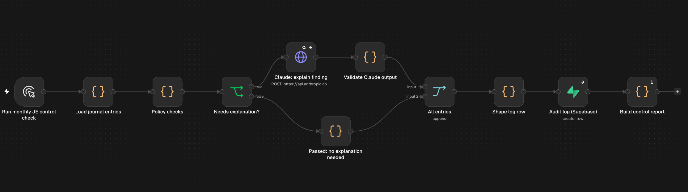
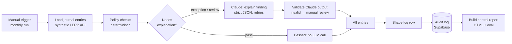

# JE control monitor: prototype of a read-only audit agent (n8n + Claude + Supabase)

A month-end control that checks every journal entry (JE) against an approval policy, explains each exception in plain English for the Financial Controller, logs every decision, and produces a monthly control report.

**The design rule:** deterministic code decides, the LLM explains. Claude never decides whether an entry passes or fails.

> Built under a 2-hour timebox as a prototype. This version runs on a fictional five-entity group ("Kestrel Group") with fresh synthetic data.

---

## The problem

In a growing multi-entity finance team, journal entries get through without the approval the policy requires. Typical causes are bulk uploads that bypass the approval step, entries approved by someone below the required level, people approving their own entries, and late entries posted into a month that's already closed.

Auditors test for exactly these things, usually after the fact and on a sample. This monitor checks **100% of entries every month**, before the auditors do, and gives the Controller a ranked exception queue rather than a raw export.

It is a **detective** control: it flags issues, it doesn't block or change entries. That keeps it safe to run alongside an existing ERP from day one.

## How it works

| Node | Role |
|---|---|
| **Run monthly JE control check** | Manual trigger (would be a schedule at month end in production). |
| **Load journal entries** | 34 synthetic September 2026 entries across UK (GBP), DE and IE (EUR), US (USD) and PL (PLN). Each has a hidden label for the issue planted in it, used only by the eval. In production this becomes an HTTP Request to the ERP's journal-entries API. |
| **Policy checks** | The policy engine, plain JavaScript. It converts each amount to EUR at fixed month-end rates, works out the required approver, and applies six checks (below). Each entry gets `pass`, `review` or `exception`, plus the policy version it was tested against. |
| **Needs explanation?** | Only `review` and `exception` entries go to Claude. Passing entries skip the LLM entirely (cheaper, faster, nothing to explain). |
| **Claude: explain finding** | Claude Haiku 4.5. The system prompt says the decision is already made and must not be changed, softened or added to. Claude returns strict JSON: `summary`, `risk`, `next_step`, `confidence`. Retries 3× and continues on error. |
| **Validate Claude output** | Parses and checks the JSON (all keys present, confidence in the allowed set). Any failure, including an API error, becomes "Explanation unavailable, review manually". The entry is never dropped. |
| **All entries / Shape log row** | Merges both branches and shapes one audit-log row per entry, pass or fail. |
| **Audit log (Supabase)** | Writes to `je_control_log` (schema in [`sql/je_control_log.sql`](sql/je_control_log.sql)). |
| **Build control report** | An HTML report showing what was checked, what passed, the exception queue, items for review, and run quality (eval score, valid explanations, rows written to the log). |

### The policy checks

Example policy: up to EUR 15,000 needs no approval, EUR 15,000 to 150,000 needs the **Controller**, and EUR 150,000 or more needs the **CFO**.

| Check | Severity | Why a Controller cares |
|---|---|---|
| Above threshold, no approval | exception | The core approval control failed. |
| Approved below the required level | exception | The approval exists but carries no weight. |
| Self-approved | exception | Segregation of duties. |
| Posted into a closed period | exception | It changes numbers that may already have been reported. |
| Entered at the weekend (by entry timestamp, not posting date) | review | An unusual-timing indicator, not a breach. |
| Round amount (≥ EUR 5,000, multiple of 1,000) | review | A classic estimate or fraud indicator, not a breach. |

## Results (synthetic data)

From a run of the workflow's own code over the bundled dataset:

| | |
|---|---|
| Entries checked | **34** |
| Passed | **22** |
| Policy exceptions | **9**, worth **EUR 767,370** |
| Flagged for review | **3** |
| Findings by type | no approval 4 · approver too junior 3 · self-approved 2 · closed period 1 · weekend 2 · round amount 2 |
| Detection eval | **34/34** entries' findings exactly match their planted labels |

One edge case is deliberately included: **PLN 65,100 converts to EUR 14,973**, just under the Controller threshold, so it passes. It shows that thresholds are applied after FX conversion, not on the face amount.

**What 34/34 does and doesn't prove.** It shows the rules do exactly what they claim on known cases, including the overlaps (one entry is both self-approved and approved below the required level). It does **not** measure real-world recall: the labels were written alongside the rules. Explanation quality depends on the live Claude run, and the report shows the valid-JSON rate for each run.

## Design decisions and trade-offs

- **Deterministic before LLM.** Thresholds, FX and segregation of duties are arithmetic and lookups, so they need to be exact and repeatable for an auditor. The LLM only does what code does badly: turning findings into a clear sentence for a busy Controller.
- **Read-only first.** A detective control can be switched on without changing anyone's process. Blocking (a preventive control) comes later, once the team trusts the findings.
- **One base currency, fixed month-end rates.** Thresholds are tested in EUR at the month-end rate recorded in the policy, and the rate is logged on every row so the check can be re-performed.
- **Policy version on every row.** If a threshold changes, history shows which policy each entry was tested against.
- **Append-only audit log.** The unique key `(run_month, entry_number, policy_version)` means rerunning the same month under the same policy can't overwrite history. Duplicate rows are rejected and counted in the report's "Audit log" line. Rerunning under a new policy version is logged alongside.
- **Never drop an entry.** An API failure or a malformed Claude reply turns into a manual-review item, not a silent gap.

## Error handling

- Claude call: 3 retries 2s apart, then continue on error; the error is caught by the validator.
- Validator: strict JSON parse and key and value checks, with a fallback to manual review.
- Supabase write: continue on error. Failed or rejected rows are counted in the report, so a broken log is visible rather than silent.

## Limitations

- Synthetic data and an example policy. Real thresholds, closed-period dates and FX rates would come from the client's own policy and ERP.
- Manual trigger; no scheduling or notifications (the next step would be posting the exception queue to Slack or Teams).
- The report is generated as an n8n binary file. It isn't emailed or hosted.
- The review flags (weekend, round amount) have no materiality weighting yet.
- The eval set is small and self-labelled (see above).
- "Approver role" is taken from the entry. In production it should be looked up from the ERP's user and permission data, not trusted from the record.

## Setup

1. Create a Supabase project and run [`sql/je_control_log.sql`](sql/je_control_log.sql).
2. In n8n, create two credentials:
   - **Anthropic**, with your Claude API key
   - **Supabase**, with your project URL and service-role key
3. Import [`workflows/je-control-monitor.json`](workflows/je-control-monitor.json) (Workflows → Import from file).
4. Open **Claude: explain finding** and **Audit log (Supabase)** and select your credentials (they're imported without any).
5. Run it. The control report is attached to the last node's output as `je_control_report_2026-09.html`.

[`sample-data/journal_entries_2026-09.csv`](sample-data/journal_entries_2026-09.csv) holds the same 34 entries as the Load node, with the planted issue in the last column.

## How it was built

I built it with Claude as my build partner, working through n8n's MCP server. I scoped the problem and made the design calls:

- a read-only detective control rather than a blocking one
- which checks to include
- testing thresholds in a single base currency
- checking when a person *entered* an entry rather than its posting date

Claude wrote the code, the synthetic data and the eval. The eval caught errors in Claude's own synthetic data along the way. I tested the run, including with the database node switched off, to confirm the report still builds.
